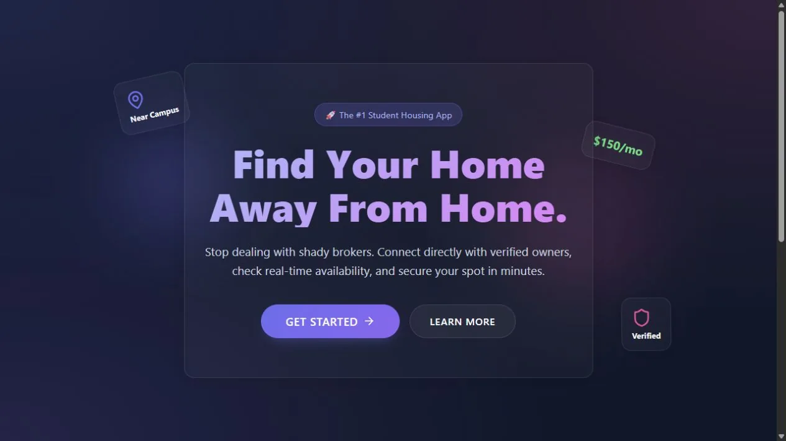
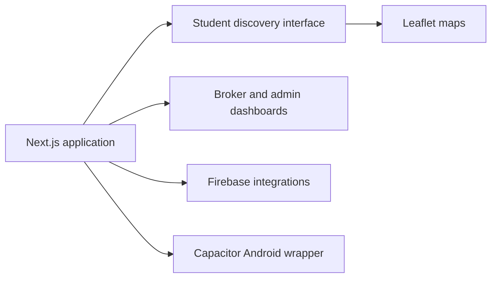

# Boarding Solution

A student-housing web application for exploring accommodation in Sri Lanka, with listing, search, comparison, and role-specific dashboard components.

[Live interface](https://boarding-solution.vercel.app/) · [Portfolio](https://mohammed-zakee.github.io/Portfolio/)



## Problem and product scope

Students need to compare accommodation by location, price, and amenities. This project brings housing discovery and account-based workflows into one application. The screenshot is the actual public landing interface; the presence of a feature in source does not independently verify listing accuracy or production readiness.

## Implementation

| Layer | Current repository technology |
|---|---|
| Web application | Next.js 16, React 19, JavaScript |
| Identity and data | Firebase Authentication and Firestore integration |
| Maps | Leaflet and React Leaflet |
| Interface | CSS, Lucide icons, Framer Motion |
| Mobile wrapper | Capacitor 7 and an Android project |

The source includes student, broker, and admin dashboards; listing comparison; saved searches; favorites; image galleries; and map components. Android source is present; no app-store publication is implied.



## Run locally

Use a Node.js version compatible with Next.js 16.

```sh
npm install
npm run dev
```

Open `http://localhost:3000`. Configure your own development Firebase project using the setup documents and `src/lib/firebase.js`. Account and database-backed flows require working Firebase configuration and appropriate rules; the landing page alone does not validate them.

```sh
npm run build
npm run start
```

These are the repository's configured commands. This README update does not claim a fresh production build or end-to-end authentication test was run.

## Source guide

| Path | Purpose |
|---|---|
| `src/app/page.js` | Public landing page |
| `src/app/student/dashboard/` | Student dashboard |
| `src/app/broker/dashboard/` | Broker workflow |
| `src/app/admin/dashboard/` | Admin workflow |
| `src/components/Map.js` | Map component |
| `src/components/CompareListings.js` | Side-by-side listing comparison |
| `src/components/SavedSearches.js` | Saved-search UI |
| `src/lib/firebase.js` | Firebase integration |
| `android/` | Capacitor Android project |

## Trade-offs and limitations

- Map-based discovery depends on location information and external map services.
- Firebase rules and server-enforced permissions need independent review before handling real users and private data.
- Listings and verification claims require operational processes beyond a user interface.
- The live landing page was visually inspected. Login, account creation, uploads, payments, listing management, and Android release behavior were not exercised in this review.
- No adoption, conversion, or performance benchmark is claimed.

## Next engineering steps

Document individual contributions, add deterministic listing fixtures and permission tests, measure mobile performance and accessibility, and validate complete student and broker journeys in a dedicated test environment.

Individual module ownership and team size are not inferred from repository ownership. Use your own development accounts; shared account credentials are intentionally omitted from this README.
